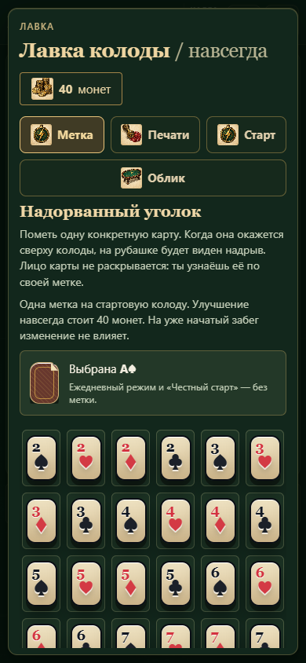

# Надорванный уголок: метка одной карты

В главном меню открой **Лавка → Метка**. Выбери конкретную карту по рангу и масти, например A♠, затем подтверди покупку. Одна метка на стартовую колоду стоит **40 монет навсегда**. После покупки выбор можно менять бесплатно между забегами или убрать метку без возврата монет. В подготовке к забегу этого улучшения нет.

Когда помеченная карта находится сверху колоды, на верхней рубашке виден надорванный уголок и небольшая подпись «надрыв». Лицо карты не показывается; игрок узнаёт её, потому что сам выбрал метку. После добора надрыв остаётся на карте, а на новой верхней рубашке его нет, если она не помечена.

Метка не двигает карту наверх, не меняет порядок перемешивания, сумму, урон или другие свойства. Это информация об одной знакомой карте. Она не расходует предмет и не включает эффект просмотра. Под джокерами есть напоминание о метке именно текущего забега, чтобы не путать её с изменённой настройкой лавки.

## Совместимость

- Применяется к следующему старту; смена настройки не меняет уже сохранённую партию.
- В ежедневном режиме и при «Честном старте» метка отсутствует.
- Выбирается один исходный экземпляр стартовой колоды. При изменении масти метка остаётся физически на карте. В Алой/Ночной колоде тоже следует за исходным экземпляром, даже если его масть преобразована.
- Если выбранной карты нет в Короткой колоде, другая карта вместо неё не помечается. Подготовка предупреждает об отсутствии.
- Копирование карты в кузнице не копирует физический надрыв. В одной стартовой колоде остаётся одна метка.
- Сброс, перемешивание и сохранение сохраняют надрыв. Если карта удалена или разбилась, в этой партии метка исчезает вместе с ней; настройка на следующий забег остаётся.
- Помеченные и обычные одинаковые лица в книге колоды учитываются отдельно, чтобы не смешивать экземпляры.

## Реализация и проверки

Настройка в `META.shop.markOwned`/`markCard`, метка экземпляра — `card.notched`. Надрыв нарисован CSS на существующей рубашке, без отдельной текстуры и постоянной анимации. Быстрый добор меняет класс рубашки на месте, сохраняя оптимизацию DOM.

`tests/playtest/card-marking.cjs`: выбор/подтверждение, списание один раз, бесплатная смена, отсутствие денег, один экземпляр, переход метки с рубашки на выложенную карту, перезагрузка, копирование, преобразование масти, отсутствие карты, отключение в честном/ежедневном режиме, неизменность перемешивания. Также проверена ширина 320/390 px.

[Метка на верхней рубашке](docs/campaign/mark-back.png)
