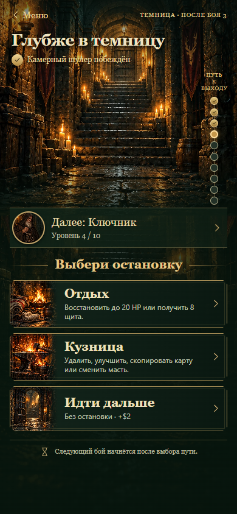
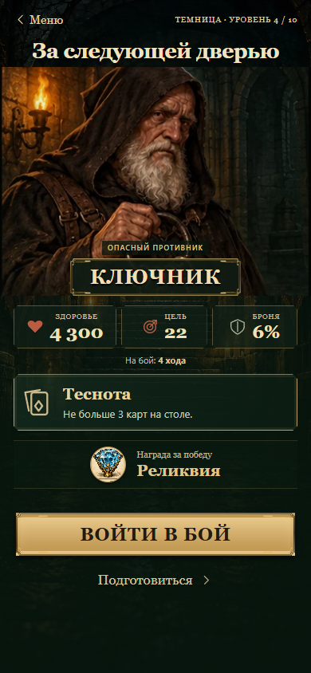

# Переходы Темницы

Два рабочих экрана построены по утверждённому референсу. HTML отображает реальные данные забега поверх отдельных иллюстраций.

Скриншоты рабочего интерфейса на примере перехода к четвёртому бою:

## Путь между противниками

- Коридор, лестница и дверь; вертикальная шкала десяти боёв с текущим шагом.
- Имя пройденного противника и представление следующего берутся из кампании.
- Иллюстрированные кнопки используют существующий выбор маршрута: отдых, кузница, событие, элита, контракт, сделка или прямой путь. Состав предложений, случайность и награды не изменены.
- У элиты можно раскрыть фактическое правило и параметры до выбора.
- «Меню» сохраняет остановку. «Продолжить» возвращает тот же выбор без повторной генерации. Системная кнопка назад не позволяет пропустить обязательный выбор.

## Перед боем

- Крупная иллюстрация соответствующего противника, имя и роль.
- Текущее HP, цель карт, броня в процентах и количество ходов.
- Действительные правила боя и контракта, награда: деньги, реликвия или выход из Темницы.
- «Войти в бой» запускает существующий бой. «Подготовиться» раскрывает текущую сборку и доступ к правилам.
- Старый режим сохраняет прежние экраны. Магазин и баланс не изменены.

## Графика

Создана встроенным imagegen по утверждённому макету:

- `assets/passage-corridor.webp` — фон коридора (360 КБ), промпт `assets/passage-corridor.prompt.txt`.
- `assets/passage-stops.webp` — шесть иллюстраций остановок (484 КБ), промпт `assets/passage-stops.prompt.txt`.
- `assets/dungeon-opponents.webp` — существующий атлас десяти противников.

Исходные PNG сохранены локально. В публикацию входят сжатые WebP без уменьшения разрешения. Фон статичен, постоянных анимаций и циклов перерисовки нет.

## Проверка

`tests/playtest/passage.cjs`: выбор пути, сохранение/продолжение, данные противника, награды, правила, запуск боя, все семь типов остановок, старый режим и отступы Telegram на ширинах 320, 390, 430 и 1282 px. Дополнительно пройдены campaign.cjs, campaign-layout.cjs и 35 проверок routes.cjs.
