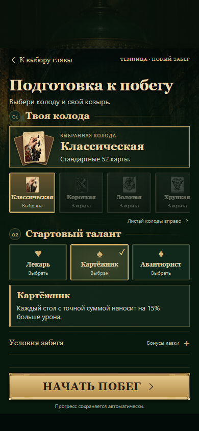

# Подготовка к побегу

Экран подготовки оформлен в одном стиле с переходами Темницы: полноэкранная сцена, латунные детали, веер карт и закреплённая кнопка начала забега.

- Выбранная колода и её эффект видны над горизонтальным выбором колод.
- Доступные таланты представлены компактными карточками. Описание выбранного таланта видно сразу; закрытые таланты и требования перечислены в «Условиях забега».
- «Честный старт» и пояснения к бонусам лавки находятся в раскрывающемся блоке.
- «Надорванный уголок» остаётся только в лавке.
- Кнопка «Начать побег» закреплена у нижнего края окна и учитывает отступы Telegram. Маленькие экраны и длинные описания сохраняют прокрутку.
- При смене колоды или таланта сохраняются положение окна и раскрытые условия.

Новая графика не загружается: используются существующие иллюстрации и CSS. Файлы: assets/preparation.js и assets/preparation.css. Игровые правила и бонусы не изменены.

Проверки: preparation.cjs на ширинах 320, 390, 430 и 1282 px с отступами Telegram; talents.cjs, card-marking.cjs, campaign-layout.cjs.
