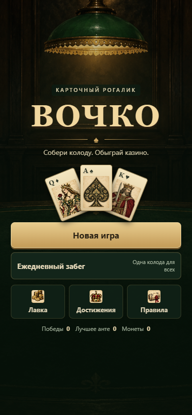

<p align="center">
  
</p>

<h1 align="center">ВОЧКО</h1>

<p align="center"><b>Двадцать одно — рогалик-колодострой</b></p>

<p align="center">
  <a href="https://rozhokserega-lang.github.io/vochko/"><b>Играть в браузере</b></a>
</p>



## Об игре

«ВОЧКО» — компактный карточный рогалик: восемь анте, по три блайнда в каждом и по четыре места на блайнд. На каждом месте три стола и одна общая колода. Взятая карта всегда идёт на текущий открытый стол — игрок решает, когда сказать «Стоп на столе» и когда «Сыграть».

За забег вы собираете джокеров, расходники и деньги, выбираете награды между блайндами и упираетесь в боссов с особыми правилами дома. Цель — пройти все восемь анте: если не добить цель блайнда, забег заканчивается.

## Как играть

1. На месте три стола. Тяните карты — они автоматически ложатся на текущий открытый стол.
2. Нажмите «Стоп на столе», когда на столе достаточно карт. Следующая карта пойдёт на следующий стол.
3. «Сыграть» завершает место: сумма каждого стола сравнивается с целью места.
4. Точная сумма фиксирует стол и приносит максимальный множитель. Перебор убивает стол.
5. Неиспользованные места приносят деньги. Между блайндами — магазин джокеров и расходников.

Больше деталей — по кнопке «Правила» в игре.

## Управление

| Действие | Мышь / тап | Клавиатура |
|---|---|---|
| Взять карту | «Взять карту» | `Space` |
| Стоп на текущем столе | «Стоп на столе» | `D` |
| Сыграть место | «Сыграть» | `S` / `Enter` |
| Выбрать стол для расходника | клик по столу | `1` / `2` / `3` |
| Закрыть правила | «Понятно» | `Enter` |

На мобильных подсказка джокера открывается тапом и превращается в нижнюю панель.

## Локальный запуск

Игра — один статический файл, сборка не нужна.

```bash
python -m http.server 8000
# открыть http://localhost:8000
```

Можно открыть `index.html` напрямую, но для проверки Telegram-интеграции удобнее локальный сервер и HTTPS-туннель.

## Структура

```
.
├── index.html          # вся игра: разметка, стили, логика
├── assets/
│   ├── icon.svg        # иконка и фавикон
│   ├── icon-180.png    # apple-touch-icon
│   └── icon-512.png    # аватар бота и og:image
├── docs/
│   └── screenshot.png
├── telegram/
│   ├── setup.mjs       # настройка меню-кнопки через Bot API
│   └── README.md
└── README.md
```

## Деплой

Сайт живёт на GitHub Pages из ветки `main`, корень репозитория:

**https://rozhokserega-lang.github.io/vochko/**

Любой `git push` в `main` обновляет игру за минуту. Никаких сборок и экшенов не требуется.

## Telegram Mini App

Telegram требует HTTPS, поэтому GitHub Pages подходит без дополнительных сервисов. Пошаговая инструкция — в [`telegram/README.md`](telegram/README.md). Коротко:

1. Создайте бота у [@BotFather](https://t.me/BotFather) (`/newbot`) и получите токен.
2. Выполните:

   ```powershell
   $env:BOT_TOKEN="123456:ABC..."
   $env:WEBAPP_URL="https://rozhokserega-lang.github.io/vochko/"
   node telegram/setup.mjs
   ```

3. Откройте бота в Telegram и нажмите кнопку «Играть» у поля ввода.

Если не хотите запускать скрипт локально, токен можно сохранить в секретах GitHub и выполнить готовый workflow:

```powershell
gh secret set BOT_TOKEN
gh workflow run telegram-setup.yml
```

Токен не коммитьте: скрипт читает его из переменной окружения или секрета. Если токен попал в историю — `/revoke` у BotFather.

## Технические детали

- Чистый HTML/CSS/JS, без сборки и зависимостей. Вся игра — один `index.html` (~90 КБ).
- Адаптив от 320 px, `dvh`, `env(safe-area-inset-*)`, нижняя панель для подсказок на тач-устройствах.
- Telegram WebApp SDK: `ready()`, `expand()`, цвета шапки и фона, тактильный отклик, `BackButton` для правил и подтверждение закрытия во время забега.
- Игра не отправляет данные на сервер и не требует бэкенда.

## Известные ограничения

- Нет сохранения: обновление страницы начинает новый забег.
- Баланс — играбельный прототип, цифры могут меняться.
- Перезапуск из HUD использует системный `confirm`.
- Звука нет.

## Идеи

- Облачные сохранения через Telegram `CloudStorage`.
- Ежедневный забег с общим сидом.
- Таблица рекордов (потребует бэкенд).
- Настройка громкости и звуки карт.
