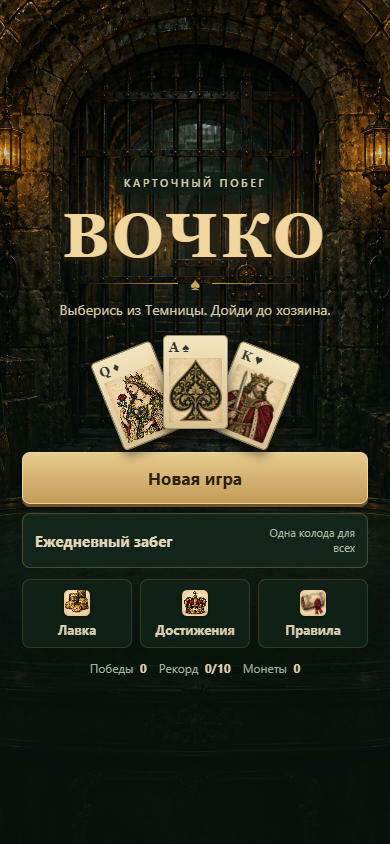
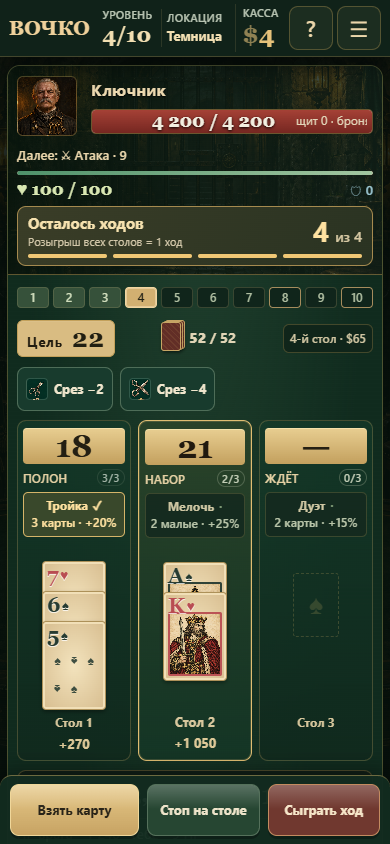

<p align="center">
  
</p>

<h1 align="center">ВОЧКО</h1>

<p align="center"><b>Двадцать одно — рогалик-колодострой</b></p>

<p align="center">
  <a href="https://rozhokserega-lang.github.io/vochko/"><b>Играть в браузере</b></a>
</p>



## Об игре

«ВОЧКО» — карточный побег из Темницы: 10 уровней, начальник на выходе и обычно четыре хода на бой. На карте пять локаций; в первом выпуске полностью доступна Темница. На каждом ходу три стола и одна общая колода. Взятая карта всегда идёт на текущий открытый стол — игрок решает, когда сказать «Стоп на столе» и когда «Сыграть».

За забег вы собираете джокеров, расходники и деньги, выбираете награды между боями и упираетесь в боссов с особыми правилами дома. Цель — пройти десять уровней и открыть следующую главу. Поражение начинает новую попытку, а достижения и покупки сохраняются. Старые сохранённые забеги можно завершить по прежним правилам.

## Актуальное обновление

Новая кампания Темницы, пошаговые бои с противниками, анимация заряда и удара, автосохранение забега и точный прогноз урона. По нажатию на колоду можно посмотреть оставшиеся карты. Добавлены джокер «На бис» (+1 ход), расходники удаления и переноса карты, резерв товара магазина и особенности четырёх врагов. Подробности — в [FEATURES.md](FEATURES.md).

Подробнее: [кампания и план 50 уровней](CAMPAIGN.md), [надорванный уголок карты](CARD-MARKING.md). В лавке перед забегом можно навсегда приобрести одну метку за 40 монет; выбор карты затем меняется бесплатно.

## История v5 — старый режим

- **Путь между боями:** перед первым и вторым боем выбирайте остановку — событие, кузницу, контракт или элитный бой.
- **Реликвии:** за победу над боссом или элитой выбирайте одну из трёх постоянных реликвий.
- **Уровни сложности и достижения:** шесть уровней сложности, прогресс и открытия хранятся в `localStorage`; есть ежедневный забег.
- **Кузница:** удаляйте, улучшайте и копируйте карты колоды; проклятые карты убираются там же.
- **Новые механики:** расходники «Перетасовка», «Дальновидность», «Сжечь», «Заморозка»; боссы «Вор», «Налог», «Чёрная ночь», «Замок»; второе правило дома на высоких уровнях сложности.
- **Графика 4.0:** новый фон, анимации карт, частицы и адаптивные оверлеи.

## Как играть

1. На ходу три стола. Тяните карты — они автоматически ложатся на текущий открытый стол. Счётчик `2/4` на каждом столе показывает, сколько карт уже лежит и сколько всего помещается.
2. Нажмите «Стоп на столе», когда на столе достаточно карт. Следующая карта пойдёт на следующий стол.
3. «Сыграть» завершает ход: сумма каждого стола сравнивается с целью карт.
4. Точная сумма фиксирует стол и приносит максимальный множитель. Перебор убивает стол.
5. Неиспользованные ходы приносят деньги. Между боями — магазин джокеров и расходников, а перед боями — путь с событиями, кузницей и контрактами.
6. После уровней 4 и 8, а также добровольной элиты выбирайте реликвию — она действует до конца забега. Уровень 10 завершает Темницу.

Больше деталей — по кнопке «Правила» в игре.



## Управление

| Действие | Мышь / тап | Клавиатура |
|---|---|---|
| Взять карту | «Взять карту» | `Space` |
| Стоп на текущем столе | «Стоп на столе» | `D` |
| Сыграть ход | «Сыграть» | `S` / `Enter` |
| Выбрать стол для расходника | клик по столу | `1` / `2` / `3` |
| Закрыть правила | «Понятно» | `Enter` |

На мобильных подсказка джокера открывается тапом и превращается в нижнюю панель.

## Локальный запуск

Игра статическая, сборка не нужна. Для запуска и публикации нужны `index.html` и вся папка `assets`.

```bash
python -m http.server 8000
# открыть http://localhost:8000
```

Можно открыть `index.html` напрямую, но для проверки Telegram-интеграции удобнее локальный сервер и HTTPS-туннель.

## Структура

```
.
├── index.html          # вся игра: разметка, стили, логика
├── assets/
│   ├── icon.svg        # иконка и фавикон
│   ├── icon-180.png    # apple-touch-icon
│   └── icon-512.png    # аватар бота и og:image
├── docs/
│   ├── screenshot.png  # экран подготовки забега
│   └── tables.png      # столы и счётчики карт
├── telegram/
│   ├── setup.mjs       # настройка меню-кнопки через Bot API
│   └── README.md
└── README.md
```

## Деплой

Сайт живёт на GitHub Pages из ветки `main`, корень репозитория:

**https://rozhokserega-lang.github.io/vochko/**

Любой `git push` в `main` обновляет игру за минуту. Никаких сборок и экшенов не требуется.

## Telegram Mini App

Telegram требует HTTPS, поэтому GitHub Pages подходит без дополнительных сервисов. Пошаговая инструкция — в [`telegram/README.md`](telegram/README.md). Коротко:

1. Создайте бота у [@BotFather](https://t.me/BotFather) (`/newbot`) и получите токен.
2. Выполните:

   ```powershell
   $env:BOT_TOKEN="123456:ABC..."
   $env:WEBAPP_URL="https://rozhokserega-lang.github.io/vochko/"
   node telegram/setup.mjs
   ```

3. Откройте бота в Telegram и нажмите кнопку «Играть» у поля ввода.

Если не хотите запускать скрипт локально, токен можно сохранить в секретах GitHub и выполнить готовый workflow:

```powershell
gh secret set BOT_TOKEN
gh workflow run telegram-setup.yml
```

Токен не коммитьте: скрипт читает его из переменной окружения или секрета. Если токен попал в историю — `/revoke` у BotFather.

## Технические детали

- Чистый HTML/CSS/JS, без сборки. `index.html` использует изображения, стили и дополнительные скрипты из `assets`; публиковать нужно оба вместе.
- Адаптив от 320 px, `dvh`, `env(safe-area-inset-*)`, нижняя панель для подсказок на тач-устройствах.
- Telegram WebApp SDK: `ready()`, `expand()`, цвета шапки и фона, тактильный отклик, `BackButton` для правил и подтверждение закрытия во время забега.
- Игра не отправляет данные на сервер и не требует бэкенда.

## Известные ограничения

- Текущий забег, достижения, открытые колоды и уровни сложности сохраняются в `localStorage` этого браузера. После обновления страницы выберите «Продолжить забег». Между устройствами прогресс автоматически не переносится.
- Баланс — играбельный прототип, цифры могут меняться.
- Перезапуск из HUD использует системный `confirm`.
- Звука нет.

## Идеи

- Облачные сохранения через Telegram `CloudStorage`.
- Таблица рекордов (потребует бэкенд).
- Настройка громкости и звуки карт.

## Тактическое обновление

Термины: **этап → бой → ход → стол**. Игровые кнопки на телефоне закреплены снизу, суммы карт показаны сверху столов, покупки подтверждаются без исчезновения карточки товара.

Выбор расходника показывает изменение суммы и урона. Перенос показывает оба стола, удаление — результат каждой карты. Скрытые карты не раскрываются, случайный эффект Алхимика учитывается как диапазон результата. Кнопка «Как считается урон?» раскрывает очки столов, эффекты, щит, броню и итоговую потерю HP. Разбор поражения показывает последний ход, переборы за бой и оставшиеся предметы.

«Синхронизация» требует точных, перебравших или заполненных столов (минимум три доступных); ручной стоп сам по себе не считается.

## Проверки

Сборка игры не нужна. Node.js 20+ и зависимости нужны только для тестов: `npm ci`, `npx playwright install chromium`, `npm test`. Баланс: `npm run test:balance`.

[Инструкция по тестам](tests/playtest/README.md) · [Результаты 280 забегов](BALANCE.md).

## Комбинации и «Маятник»

- Три или больше тузов на одном столе: крит ×2 к очкам этого стола, если нет перебора. Усиливается очками джокеров и стекла, но не игнорирует щит и броню.
- Три или больше королей на одном столе: защита от перебора. Реальная сумма сохраняется; множитель зависит от расстояния до цели, точное попадание не выдаётся автоматически.
- Четвёртая карта не отменяет комбинацию. Бонус каждой комбинации срабатывает один раз.
- Босс «Маятник»: цель каждого хода идёт по циклу 21 → 18 → 25 → 21, независимо от этапа. Следующая цель видна заранее, текущая фиксируется до конца хода и сохраняется при перезагрузке. Правило не совмещается с «Горячей целью» и «Урезанной целью».

При цели 18 два короля ещё дают перебор: защита появляется только с третьим. Собрать тройку можно, в частности, переносом карты с другого стола.
