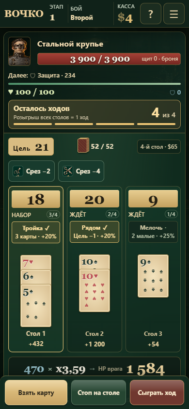

# Особенности столов на один бой

Со второго боя каждого забега столы получают разные случайные особенности. Первый бой остаётся обычным. Особенности назначаются один раз перед боем, действуют все его ходы и заново выбираются перед следующим противником. После перезагрузки набор не меняется. У купленного четвёртого стола тоже есть особенность.

| Особенность | Условие без перебора | Бонус к урону этого стола |
|---|---|---:|
| Дуэт | Ровно 2 карты | +15% |
| Тройка | Ровно 3 карты | +20% |
| Добор | 4 и более карт | +20% |
| Мелочь | Не менее двух карт рангов 2–5; остальные могут быть любыми | +25% |
| Рядом | Сумма на единицу ниже текущей цели | +20% |

Особенности не меняют значение карт, лимит или расход ходов. При переборе бонуса нет. На бою с правилом «Теснота» не назначается «Добор», поскольку собрать четыре карты невозможно. На заблокированном столе бонус не работает.

Решение, когда остановиться, теперь учитывает условие стола: четвёртая карта убирает бонус «Тройки», точная сумма убирает бонус «Рядом», а срез или перенос может включить бонус. «Мелочь» смотрит на напечатанный ранг, поэтому улучшение карты ранга 4 не лишает её принадлежности к малым картам. Заморозка суммы не замораживает количество карт: добор продолжает менять условия.

Условие видно на каждом столе. Срабатывание отмечено цветом и галочкой. Перед боем раскрыт список точных описаний; во время боя его можно открыть под панелью джокеров. Очки под картами учитывают эффекты этого стола; общие бонусы хода остаются в итоговом прогнозе. Разбор урона содержит название сработавшей особенности.

## Расчёт и сохранения

Бонус применяется к очкам конкретного стола после бонусных чипов «Эстафеты», до таланта Картёжника, цветовых и общих комбинаций. Бонусы разных столов не перемножаются друг с другом. В прогнозах расходников используется тот же расчёт, что при настоящем ударе.

`tableFeatures` хранится в текущем сохранении вместе с боем. Старый сохранённый бой без поля продолжается с обычными столами; особенности появятся перед следующим противником. Ежедневные забеги получают набор из своего детерминированного RNG. Порядок добора для назначения не читается.

## Проверки

`tests/playtest/table-features.cjs`: 51 проверка — назначение/уникальность, первый бой, четвёртый стол, сохранение, ограничение трёх карт, каждый бонус и перебор, неизменность суммы, потеря бонуса при доборе, расходник/перенос, прогноз против фактического боя для всех пяти талантов и особенностей, старые сохранения. Дополнительно проверены 3/4 стола на 320/390 px без переполнения подписей.

Прошли проверки прогрессии, комбинаций, тактического интерфейса, ввода карт, визуальной компоновки, производительности и анимации атаки.

100 обычных автоматических забегов с классической колодой и талантом Картёжника завершились без ошибок; 31 победа, средняя глубина 16,23 боя. Все открытия доступны, бонусов лавки нет. Бот использует фиксированную политику, не оптимизирует остановку специально под каждый стол. Это технический прогон, не оценка вероятности победы игрока. Назначение особенностей меняет последовательность RNG, поэтому результаты нельзя прямо сравнивать с прежними сериями как чистое измерение силы бонусов.

Постоянных анимаций и таймеров нет. Расчёт столов переиспользуется для цифр на поле и итогового прогноза, чтобы не возвращать лишнюю работу при доборе.
