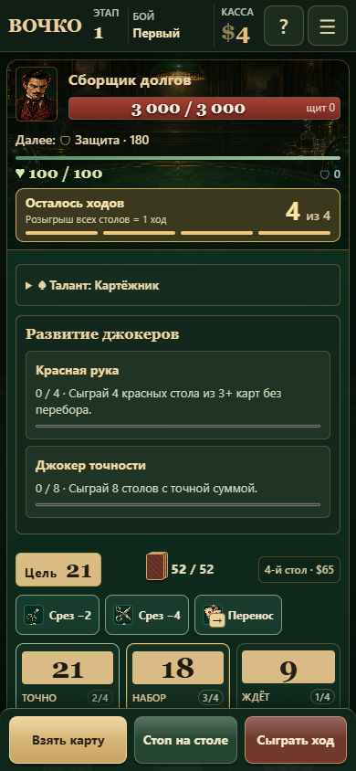
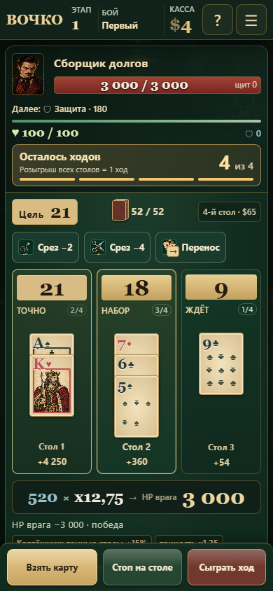

# Проверка графики и интерфейса — 29 октября 2026

Просмотрены главное меню, подготовка, бой, магазин, развилки, кузница и развитие джокера. Сохранены зелёное сукно, латунные акценты, старые иллюстрации и бумажные карты.

## Исправления

- **Порядок боевого экрана.** Блок талантов и развития получал нулевой flex-order и вставал перед целью, расходниками и столами. Теперь он расположен после джокеров, а подробности развития свёрнуты. Счётчики и готовность улучшения видны в строке. Открытое описание не закрывается при каждой перерисовке.
- **Карты.** В трёх столах карты увеличены до 64×89 px, ранги — до 21 px. Для четырёх столов оставлен компактный вариант 51×72 px. Подписи столов не перекрываются картами. Кузница, книга колоды и удаление используют такую же тёплую бумагу вместо отдельного белого оформления.
- **Фон и панели.** У поля единое спокойное сукно; карточки и цифры контрастнее. Приведены к общей палитре полоска ходов, окна, маршруты, кнопки кузницы и прогресс развития. Новых изображений и постоянных анимаций нет.
- **Магазин.** Убрано повторяющееся слово «Джокер» рядом с меткой редкости; сама редкость остаётся текстом и цветом. Выровнены иллюстрации, названия, описания и нижняя панель магазина.
- **Подготовка.** Вместо пяти длинных карточек талантов — компактная сетка с отдельным описанием выбранного таланта. Закрытые варианты показывают условие открытия читаемым текстом.
- **Доступность.** Явная рамка клавиатурного фокуса; сенсорные кнопки сохраняют размер. Убрано общее затемнение текста закрытых талантов — приглушаются украшения, условие остаётся читаемым.

## Сравнение

| До | После |
|---|---|
|  |  |

[Подготовка](docs/visual-polish/setup-after.png) · [Магазин](docs/visual-polish/shop-after.png)

Снимки — тестовые состояния интерфейса, без Telegram chrome. Проверка отступов Telegram выполнена отдельно с моделируемыми системными/content safe areas.

## Проверки

`tests/playtest/visual-polish.cjs` проверяет 320×568, 390×844, 430×932 и 1024×768: безопасные отступы, отсутствие горизонтального переполнения, 3/4 стола в ряд, порядок блоков, свёрнутый прогресс, сохранение раскрытия, выбор таланта, читаемость меток редкости и границы модального окна. Карты не перекрывают подписи столов.

Также прошли проверки прогрессии, тактического интерфейса, комбинаций и мобильной производительности. Правила боя и значения баланса не менялись. Для коротких экранов остаётся вертикальная прокрутка; фиксированные кнопки доступны внизу.
