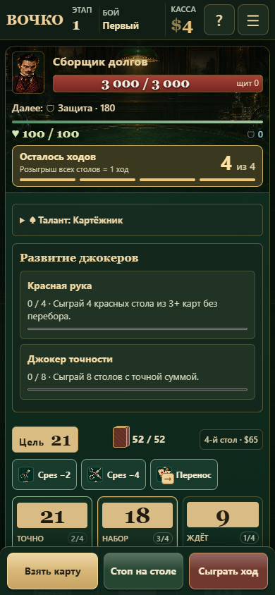
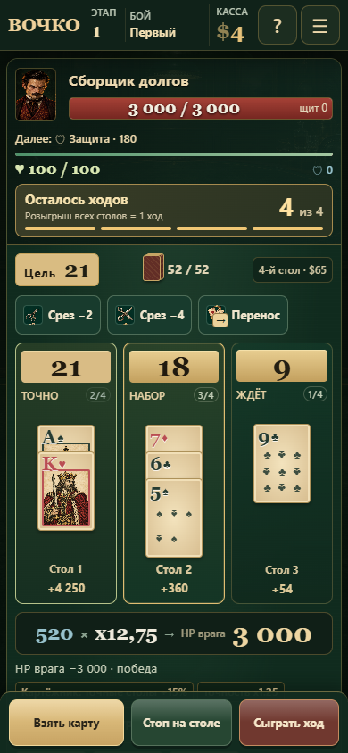

# Проверка графики и интерфейса — 29 октября 2026

Просмотрены главное меню, подготовка, бой, магазин, развилки, кузница и развитие джокера. Сохранены зелёное сукно, латунные акценты, старые иллюстрации и бумажные карты.

## Исправления

- **Порядок боевого экрана.** Блок талантов и развития получал нулевой flex-order и вставал перед целью, расходниками и столами. Теперь он расположен после джокеров, а подробности развития свёрнуты. Счётчики и готовность улучшения видны в строке. Открытое описание не закрывается при каждой перерисовке.
- **Карты.** В трёх столах карты увеличены до 64×89 px, ранги — до 21 px. Для четырёх столов оставлен компактный вариант 51×72 px. Подписи столов не перекрываются картами. Кузница, книга колоды и удаление используют такую же тёплую бумагу вместо отдельного белого оформления.
- **Фон и панели.** У поля единое спокойное сукно; карточки и цифры контрастнее. Приведены к общей палитре полоска ходов, окна, маршруты, кнопки кузницы и прогресс развития. Новых изображений и постоянных анимаций нет.
- **Магазин.** Убрано повторяющееся слово «Джокер» рядом с меткой редкости; сама редкость остаётся текстом и цветом. Выровнены иллюстрации, названия, описания и нижняя панель магазина.
- **Подготовка.** Вместо пяти длинных карточек талантов — компактная сетка с отдельным описанием выбранного таланта. Закрытые варианты показывают условие открытия читаемым текстом.
- **Доступность.** Явная рамка клавиатурного фокуса; сенсорные кнопки сохраняют размер. Убрано общее затемнение текста закрытых талантов — приглушаются украшения, условие остаётся читаемым.

## Сравнение

| До | После |
|---|---|
|  |  |

[Подготовка](docs/visual-polish/setup-after.png) · [Магазин](docs/visual-polish/shop-after.png)

Снимки — тестовые состояния интерфейса, без Telegram chrome. Проверка отступов Telegram выполнена отдельно с моделируемыми системными/content safe areas.

## Проверки

`tests/playtest/visual-polish.cjs` проверяет 320×568, 390×844, 430×932 и 1024×768: безопасные отступы, отсутствие горизонтального переполнения, 3/4 стола в ряд, порядок блоков, свёрнутый прогресс, сохранение раскрытия, выбор таланта, читаемость меток редкости и границы модального окна. Карты не перекрывают подписи столов.

Также прошли проверки прогрессии, тактического интерфейса, комбинаций и мобильной производительности. Правила боя и значения баланса не менялись. Для коротких экранов остаётся вертикальная прокрутка; фиксированные кнопки доступны внизу.

# Компактные столы и устойчивая вёрстка — 31 октября 2026

Столы занимали почти всю высоту поля: строка бонуса, комбо и предпросмотр расходника добавляли 12–70 px и раздвигали ряд, а длинная подсказка в нижней панели увеличивала док и наезжала на столы.

## Изменения

- **Одинаковые отступы.** У всех состояний стола (`active`, `ok`, `hit`, `over`) одинаковые внутренние отступы и зазор; `min-height` стола задан явно, поэтому высота ряда не зависит от состояния.
- **Фиксированный слот отклика.** Строка бонуса «♥ +10 HP · ещё 1», комбо и предпросмотр расходника живут в блоке `.t-feedback` фиксированной высоты (36 px на трёх столах, 42 px на четырёх). Место под строку бонуса зарезервировано всегда, лишнее прокручивается внутри слота. Ряд столов больше не прыгает при комбо и расходнике.
- **Плавающая подсказка.** `#dock #hint` показывается над нижней панелью и не увеличивает её высоту.
- **Стопка карт.** `assets/stable-tables.js` уменьшает шаг наложения, пока все карты не уместятся в блок; при 1–3 картах вид не меняется. Игровую логику скрипт не трогает.
- **Свечение.** Усилено тёплое свечение активного, готового и переполненного стола, чтобы состояние читалось без опоры на цвет карт.
- **Резерв строки намерения.** `#enemy-intent` держит постоянную высоту, туториал — три строки текста, поэтому верх столов не съезжает между ходами.

## Замеры

390×844: ряд столов 374 → 320 px, четыре стола 374 → 320 px. 360×640: 346 → 273 px. Зазор под последней картой стопки из пяти — 41 px (390×844) и 36 px (360×640). При комбо и расходнике высота ряда не меняется, док остаётся 65,6 px.

## Проверки

`tests/playtest/visual-polish.cjs`, `table-features`, `fast-draw`, `input-feedback`, `mobile-performance`, `campaign-layout` и `tutorial` проходят на 320×568, 360×640, 390×844, 430×932 и 1024×768. Печати на картах и полёт карт в атаке сохранены.
